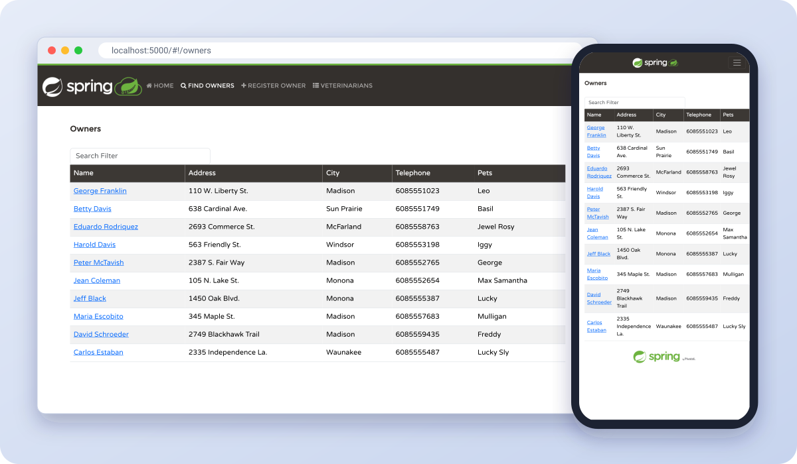

[](https://github.com/giis-uniovi/retorch-st-petclinic/actions)

# RETORCH PetClinic End-to-End Test Suite

This repository contains a detached fork of
[spring-petclinic-microservices](https://github.com/giis-uniovi/spring-petclinic-microservices) and an
End-to-End Test suite that are used as demonstrator of the [RETORCH Framework](https://github.com/giis-uniovi/retorch).
Spring PetClinic Microservices is a sample reference application based on the
[original Spring PetClinic](https://github.com/spring-petclinic/spring-petclinic-microservices), rebuilt as a
distributed microservices architecture using Spring Cloud, Spring Cloud Gateway, Eureka, Zipkin, Grafana and Prometheus,
all running in Docker containers.

<p align="center">
  
</p>

## Prerequisites

- Java 8 or newer and Maven 3.8+ (to run the tests).
- [Docker Desktop](https://www.docker.com/products/docker-desktop/) (Windows / macOS) or Docker Engine (Linux), with Docker Compose v2.
- Git (the deployment script clones the SUT).
- Google Chrome (the UI tests drive a local Chrome through Selenium).

## SUT deployment

### Local deployment

The SUT is **not** stored in this repository: `deploy.sh` (Linux / macOS) and `deploy.ps1` (Windows) clone
`spring-petclinic-microservices` (needed to build the Grafana and Prometheus images), create the `jenkins_network` Docker network if
it does not exist, build the images, start the containers (project `default`, `.retorch/envfiles/local.env`) and wait up to
200 seconds for the application to be ready.

| Linux / macOS | Windows (PowerShell) | What it does |
|---|---|---|
| `./deploy.sh` | `.\deploy.ps1` | Builds the images and deploys the SUT on the default port (5000) |
| `./deploy.sh --port 9090` | `.\deploy.ps1 -Port 9090` | Same, on another port |
| `./deploy.sh --no-build` | `.\deploy.ps1 -NoBuild` | Same, reusing the images already built |
| `./deploy.sh --down` | `.\deploy.ps1 -Down` | Tears down all containers and volumes |

(The first time on Linux / macOS: `chmod +x deploy.sh`.)

Once the SUT is ready the application is at `http://localhost:<port>` (default http://localhost:5000).

### Jenkins CI deployment

The repository contains a `Jenkinsfile` and the lifecycle scripts in `.retorch/` that run the test suite in CI. They are
**generated** by the [RETORCH tool](https://github.com/giis-uniovi/retorch) from the `@AccessMode` annotations of the tests: do
not edit them by hand. After adding or changing tests, regenerate them with `orchestrate.ps1` (it needs the
`retorch-orchestration-*-standalone.jar` of the RETORCH tool in the repository root and Maven in the path).

- The pipeline runs on a Jenkins agent labelled `xretorch-agent` with Docker (Compose v2), Java and Maven.
- Every TJob deploys its **own** copy of the SUT (`--env-file .retorch/envfiles/<tjob>.env -p <tjob>`) on the external Docker
  network `jenkins_network`, runs the tests assigned to it (`mvn test -Dtest=... -DTJOB_NAME=<tjob> -DSUT_URL=<url>`) and
  tears the deployment down. TJobs of the same stage run in parallel.
- `.retorch/configurations/retorchCI.properties` holds the SUT particularities used by the generated scripts (how to wait for
  the SUT, where its sources are, its URL inside the Docker network). With `profiling=true` the pipeline also measures the
  CPU, memory and storage of every TJob and publishes the **usage profile** (`artifacts/usageprofile/usageprofile.html`, report
  "RETORCH Usage Profile"). The profiling tool is prepared by `.retorch/customscriptscode/custom-usageprofile` (it builds it from
  source, so the agent also needs Git); delete that file once a release publishes the jar.
- Custom commands of each lifecycle phase live in `.retorch/customscriptscode/`.

Particularities of this SUT:

- The coi-setup step clones the SUT (`spring-petclinic-microservices`) into the workspace (`custom-coi-setup`); the agent needs
  access to GitHub.
- The application is reached inside the Docker network at `http://<tjob>-api-gateway:8080`.
- The GitHub Actions workflow (`.github/workflows/test.yml`) only compiles the project; the tests are executed by Jenkins.

## Running the tests

With the SUT deployed (see [Local deployment](#local-deployment)) run the whole suite from the repository root:

```bash
mvn test
```

To run a single class or method:

```bash
mvn test -Dtest=<TestClass>
mvn test -Dtest="<TestClass>#<testMethod>"
```

The target of the tests is resolved in this order: the `SUT_URL` system property, the `SUT_URL` environment variable and, if
none is set, the default local URL (`http://localhost:5000`). To test another deployment:

```bash
mvn test -DSUT_URL=http://localhost:9090
```

The CI pipeline also passes `-DTJOB_NAME=<tjob>` (the name of the TJob running the tests) together with `-DSUT_URL`.

The suite has browser tests (`giis.petclinic.e2e.functional.tests`: owners, pets, visits, vets, navigation) and API tests
(`giis.petclinic.e2e.functional.tests.api`, through the API gateway). Set `SELENOID_PRESENT` to run the browsers in a Selenoid /
Selenium Grid instead of a local Chrome.

---

<p align="center">
  <a href="https://giis.uniovi.es/"></a>
</p>
